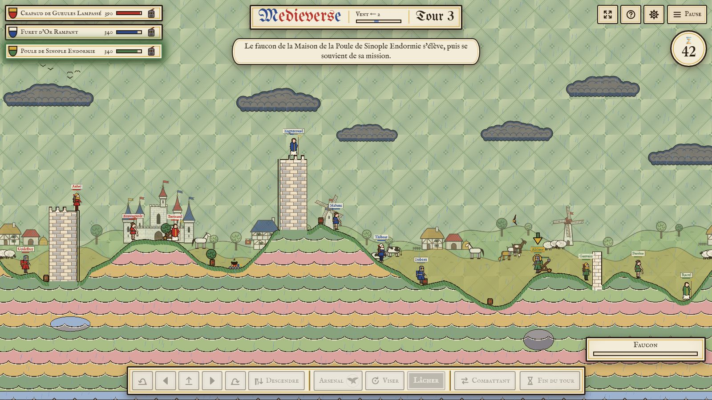
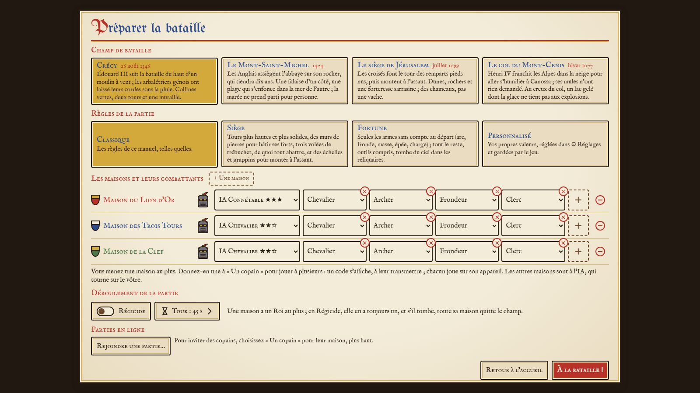
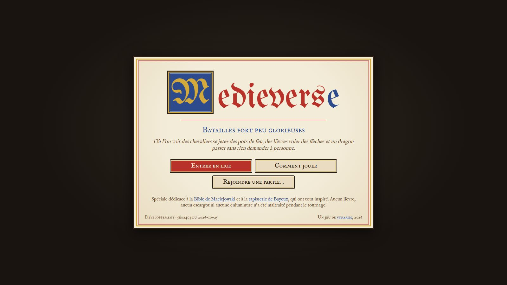
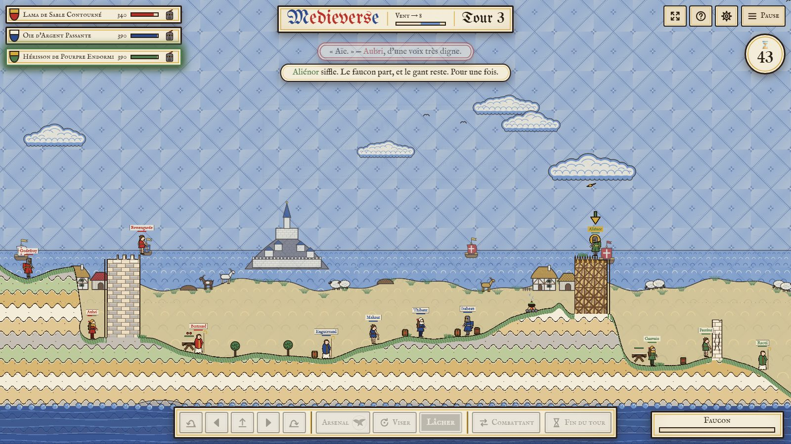
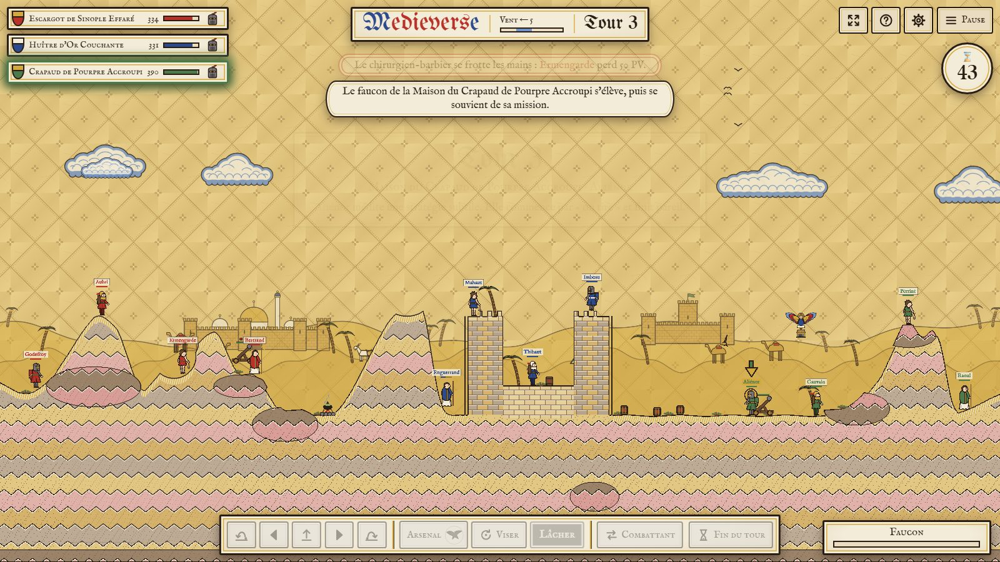
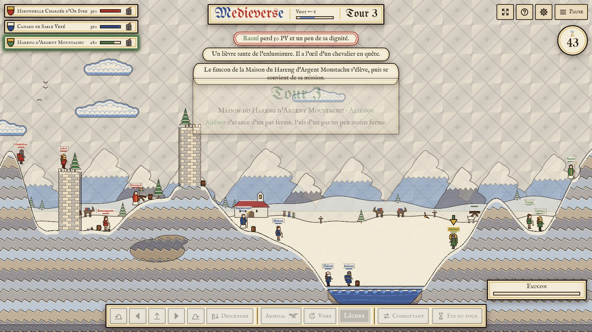
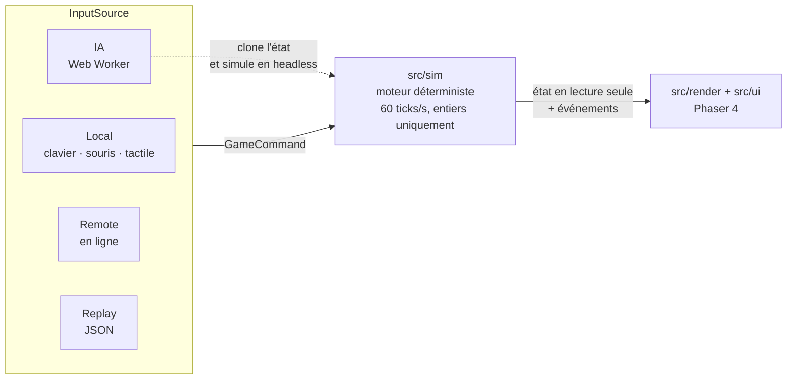

<div align="center">

# Medieverse

**Des armées enluminées sortent des pages d'un manuscrit du XIIIᵉ siècle et s'affrontent à l'arc, au trébuchet et au feu grégeois, sur des paysages peints qui s'effritent à chaque tir.**

Jeu Web 2D d'artillerie au tour par tour, dans l'esprit de *Worms*, dessiné à la manière de la [Bible de Maciejowski](https://fr.wikipedia.org/wiki/Bible_de_Maciejowski) (Paris, vers 1250).

**[▶ Jouer dans le navigateur](https://medieverse-06.web.app)**




</div>

> [!NOTE]
> Le jeu est **jouable** : contre l'IA, ou en ligne entre copains, chacun sur son appareil. Les graphismes sont une première passe « à la manière de », dessinée en code ; les illustrations définitives viendront avec le pipeline artistique (jalon M6). Voir la [feuille de route](#feuille-de-route).

---

## Sommaire

- [Le jeu](#le-jeu)
- [Direction artistique](#direction-artistique)
- [Architecture](#architecture)
- [Démarrer](#démarrer)
- [Feuille de route](#feuille-de-route)
- [Documentation](#documentation)
- [Contribuer](#contribuer)
- [Références et droits](#références-et-droits)

## Le jeu

### Les quatre piliers

| | Pilier | En pratique |
|---|---|---|
| 📜 | **Le manuscrit vivant** | Tout ressemble à une page enluminée : aplats, cernes noirs, fonds diaprés, cadres architecturés. |
| 💥 | **Chaos lisible** | Physique imprévisible mais toujours compréhensible. Chaque tir raté peut devenir drôle. |
| ⏳ | **Tour par tour accessible** | Une partie se comprend en 2 minutes et se maîtrise en 20 heures. |
| 🌐 | **Chacun son écran** | Contre l'IA, ou en ligne entre copains : chacun rejoint la partie avec un code. Jamais à deux sur le même appareil. |

Le ton est **burlesque**, façon Monty Python : les personnages gardent la gravité figée des enluminures, visages impassibles et gestes hiératiques, mais subissent des catastrophes absurdes, commentées dans des phylactères. Pas de sang : les coups font voler des étoiles, des plumes et des éclats de vélin. Public visé : 10 ans et plus.

### Une partie

2 à 4 maisons héraldiques s'affrontent, chacune avec 1 à 6 combattants (4 par défaut), sur une carte **redessinée à chaque partie**. Les maisons posent leurs combattants à tour de rôle, puis jouent chacune son tour, de 45 secondes par défaut (30, 60 ou 90 au choix) : marcher **ou** sauter, choisir une arme, viser, tirer, et finir sa marche. Le vent change à chaque tour. Après 20 tours vient **le Déluge** : « Et les eaux montèrent… », et le niveau de l'eau grimpe à chaque fin de tour, pendant que le parchemin brûle par les deux bouts. La dernière maison debout l'emporte ; en **Régicide**, c'est celle qui garde son Roi.

Quatre jeux de règles au choix : **Classique**, **Siège** (tours plus hautes, murs à bâtir, trébuchets), **Fortune** (presque tout tombe du ciel dans des reliquaires) et **Personnalisé** (vos propres valeurs, dans ⚙ Réglages).

<table>
<tr>
<td width="50%"></td>
<td width="50%"></td>
</tr>
<tr>
<td align="center"><sub>Préparer la bataille : carte, règles, maisons, combattants et qui les mène</sub></td>
<td align="center"><sub>L'écran titre</sub></td>
</tr>
</table>

### Six classes, un arsenal commun

Toutes les unités partagent le même arsenal. Chaque classe ajoute un passif.

| Classe | Passif |
|---|---|
| **Chevalier** | Haubert : −25 % de dégâts d'explosion reçus, mais saute moins haut |
| **Archer** | Œil exercé : ligne de visée plus longue à l'arc et à l'arbalète |
| **Frondeur** | Bras souple : fronde et pots partent plus vite |
| **Sapeur** | Maître d'œuvre : creuse deux fois plus vite et voit les chausse-trapes ennemies |
| **Clerc** | Bénédiction : soigne les alliés proches à la fin de son tour |
| **Roi** | Majesté : les alliés proches frappent plus fort. Sa chute élimine sa maison en Régicide |

### Un arsenal du XIIIᵉ siècle

- **Tir et lancer** : arc, flèches enflammées, arbalète, fronde, pot de feu grégeois à mèche réglable, pot de poix à fragmentation, **cochon enflammé** qui trotte tout seul, **ruche** dont l'essaim poursuit l'ennemi, faucon qui contourne le relief.
- **Frappes hors champ** : volée de trébuchet, pluie de flèches.
- **Mêlée** : épée, masse d'armes, charge à l'écu.
- **Utilitaires** : grappin, échelle, mur de pierres, bannière-parachute, pioche, sape, chausse-trape, et **Miracle** pour se téléporter.
- **Machines de siège** posées sur les cartes, que tout combattant peut servir : baliste, scorpion, catapulte, trébuchet, bélier.
- **Reliquaires** : un ange descend en planant et dépose un coffret : une arme, une fiole de baume… ou un piège.
- **Les marges s'en mêlent** : lièvres et escargots qui attaquent tout le monde, un dragon qui mord quiconque le provoque, une licorne de passage, une cuisine de campagne qui soigne qui la touche.

### Modes de jeu

| Mode | État |
|---|---|
| Contre l'IA, à trois niveaux (Écuyer, Chevalier, Connétable) | ✅ |
| En ligne, de 2 à 4 joueurs, chacun sur son appareil : une maison « Un copain » par invité, un code à leur transmettre | ✅ |
| Mixte : copains en ligne et maisons de l'IA dans la même partie | ✅ |
| IA contre IA, pour regarder | ✅ |
| Visionneuse de replays | ✅ |

### Quatre champs de bataille historiques

Chaque carte est tirée au hasard de son thème : collines, tours, rochers et machines changent de place à chaque partie.

| | |
|:---:|:---:|
|  |  |
| **Crécy**, 26 août 1346 — collines, moulins, deux tours et une muraille | **Le Mont-Saint-Michel**, 1424 — une falaise, une plage qui s'enfonce dans la mer |
|  |  |
| **Le siège de Jérusalem**, juillet 1099 — dunes, rochers, forteresse sarrasine | **Le col du Mont-Cenis**, hiver 1077 — un lac gelé dont la glace cède aux explosions |

À venir : le Pont des Tourelles (Orléans, 1429), le Chantier de la cathédrale, la Boue d'Azincourt (1415). Détail dans le [GDD §10](docs/GDD.md).

### Plateformes

Navigateur, installable comme une application (PWA). Sur **PC**, au clavier et à la souris ; sur **tablette**, au tactile, avec un pad virtuel et des cibles de 48 px au moins ; sur **téléphone**, en paysage ou tenu en portrait. On vise en faisant glisser la pointe de la flèche de visée, en tirant l'unité en arrière comme une fronde (*drag-to-aim*), ou au clavier avec la jauge de puissance.

## Direction artistique

La charte s'inspire de la Bible de Maciejowski (Morgan Library, MS M.638) :

- **aplats** de couleurs franches, sans dégradé lisse ;
- **cernes** noir-brun d'épaisseur constante ;
- **pas de perspective** : profils et trois-quarts plats ;
- **fonds diaprés**, en losanges, à la couleur de chaque carte ;
- sol en bandes ondulées, arbres en boules de feuillage, eau en volutes.

Les personnages sont des **pantins articulés** (*cutout rigs*) dont les pièces de couleur se teintent aux émaux de chaque maison.

Palette de référence :

| Lapis | Azur | Vermillon | Vert-de-gris | Ocre | Or | Vélin | Encre |
|:---:|:---:|:---:|:---:|:---:|:---:|:---:|:---:|
|  |  |  |  |  |  |  |  |
| `#2c4a8c` | `#6f93c9` | `#b8322a` | `#4d7a4a` | `#c99a3e` | `#d4a93c` | `#e9dcc0` | `#2a1d14` |

Le détail est dans [docs/ASSETS.md](docs/ASSETS.md) : charte, conventions, liste exhaustive des assets et pipeline de production.

## Architecture

Le cœur du jeu est une **simulation déterministe**, un module TypeScript pur sans aucune dépendance au rendu. Avec la même seed et le même journal de commandes, on obtient toujours, au bit près, le même état final. C'est ce qui rend possibles les replays, l'IA (qui simule des coups en arrière-plan) et le jeu en ligne en lockstep, où seuls les ordres des joueurs circulent.



| Principe | Mise en œuvre |
|---|---|
| Pas fixe | 60 ticks/s. Le rendu interpole entre deux ticks. |
| Entiers uniquement | Positions en sub-pixels (1 px = 256), angles en *binary angle* (4096 = 360°), temps en ticks |
| Pas de flottants transcendants | LUT trigonométrique figée, `isqrt` entière, PRNG seedé |
| Physique maison | Collision pixel contre un masque bitmap. Pas de Matter.js ni de Box2D. |
| Terrain destructible | Masque `Uint8Array` découpé en chunks de 256², couche peinte en tuiles de 512² |
| Cartes générées | Relief, tours, rochers et machines tirés de la seed de la partie : le replay redessine la même carte |
| En ligne | Lockstep par tour sur Firebase Realtime Database (boîte aux lettres, connexion anonyme) : jusqu'à 4 joueurs, l'IA calculée chez celui qui crée la partie ([ADR 0002](docs/adr/0002-online-transport.md)) |
| Contrôle automatique | Règle ESLint qui interdit `Math.random`, `Math.sin`, `Date`, `performance`, le DOM et Phaser dans `src/sim/**` ; rejeu des replays de référence ; mêmes calculs vérifiés dans Node, Chromium, Firefox et WebKit |

**Stack** : [TypeScript](https://www.typescriptlang.org/) strict · [Phaser 4](https://github.com/phaserjs/phaser) pour le rendu, les entrées et l'audio ([pourquoi la v4](docs/adr/0001-phaser-version.md)) · [Firebase](https://firebase.google.com/) (en ligne, hébergement) · [Vite](https://vite.dev/) · [Vitest](https://vitest.dev/) · [Playwright](https://playwright.dev/) · [ESLint](https://eslint.org/) + [Prettier](https://prettier.io/) · [pnpm](https://pnpm.io/)

```
src/
  sim/        moteur déterministe (state, tick, physics, terrain, weapons, rules)
    math/     fixed-point, LUT trigo, PRNG, hash
  ai/         IA (Web Worker, utilise sim/ en headless)
  net/        en ligne : protocole, lockstep, transports (mémoire, Firebase)
  input/      InputSource : Local, AI, Remote, Replay
  render/     scènes Phaser, tuiles de terrain, décors, VFX, caméra
  ui/         menus, HUD, options
  content/    données typées : armes, classes, cartes, factions, textes
  app/        bootstrap, enchaînement des écrans, réglages, parties en ligne
tools/        outils en ligne de commande (replays, soaks, batteries, manuel)
tests/        Vitest, garde-fou ESLint, replays de référence
docs/         GDD, spécification technique, assets, backlog, ADR, rapports, manuel
```

## Démarrer

**Prérequis** : [Node.js](https://nodejs.org/) 24 ou plus et [pnpm](https://pnpm.io/installation) 12.

```bash
git clone https://github.com/vynarim/Medieverse.git
cd Medieverse
pnpm install
pnpm exec playwright install chromium firefox webkit   # pour pnpm run test:browser
pnpm run dev        # http://localhost:5173
```

| Commande | Rôle |
|---|---|
| `pnpm run dev` | Serveur de développement Vite |
| `pnpm run build` | Typecheck puis build statique dans `dist/` |
| `pnpm test` | Tests Vitest (Node) |
| `pnpm run test:determinism` | Rejoue les replays de référence de `tests/replays/` et compare leurs hashes |
| `pnpm run test:browser` | Déterminisme : mêmes calculs dans Node, Chromium, Firefox et WebKit, résultats identiques au bit près |
| `pnpm run check` | Lint, typecheck, tests, replays et test navigateur : à faire passer avant chaque commit |
| `pnpm run lint` · `pnpm run typecheck` · `pnpm run format` | ESLint (zéro warning), `tsc --noEmit`, Prettier |
| `pnpm run maps:soak <thème\|all> --games N` | Parties IA contre IA sur une carte : combattants coincés, parties sans fin, désyncs |
| `pnpm run balance:battery -- --games N --levels a,b` | Batterie de parties IA contre IA en parallèle, synthèse d'équilibrage dans `docs/reports/balance/` |
| `pnpm run replays:record` | Enregistre les replays de référence manquants |
| `pnpm run sim:headless <replay.json>` | Rejoue une partie sans rendu |
| `pnpm run manual` | Régénère le PDF du manuel du joueur depuis `docs/manual/manuel.md` |

> [!TIP]
> Le dépôt active le [global virtual store](https://pnpm.io/global-virtual-store) de pnpm (`pnpm-workspace.yaml`). `node_modules` ne contient alors que des liens vers le store de la machine. Les dépendances ne sont téléchargées qu'une fois par machine, quel que soit le nombre de clones.

## Feuille de route

| Jalon | Contenu | État |
|---|---|---|
| **M0** | Fondations : choix de Phaser, scaffold, garde-fou ESLint, `check` | ✅ [gate](docs/reports/gates/2026-10-24-M0.md) |
| **M1** | Noyau de simulation headless : math entière, terrain, unités, projectiles, explosions, tours, replays, déterminisme | ✅ [gate](docs/reports/gates/2026-10-24-M1.md) |
| **M2** | Greybox jouable dans le navigateur, PC et tablette | 🟡 tout est vert sauf deux vérifications humaines (60 fps à l'écran, tablette réelle) — [gate](docs/reports/gates/2026-10-24-M2.md) |
| **M3** | Règles complètes : vent, reliquaires, Déluge, classes, schémas, structures | ✅ [gate](docs/reports/gates/2026-10-24-M3.md) |
| **M4** | Arsenal complet, machines de siège | 🟡 livré, gate en attente de vérifications humaines — [gate](docs/reports/gates/2026-10-25-M4.md) |
| **M5** | IA à trois niveaux | 🟡 livrée, gate en attente — [gate](docs/reports/gates/2026-10-25-M5-bis.md) |
| **M6** | Pipeline artistique et *vertical slice* | à venir |
| **M7** | Contenu V1 : cartes, maisons, replays | ⏳ en cours (quatre cartes générées, visionneuse de replays) |
| **M8** | Finition et plateforme : PWA, options, accessibilité | ⏳ en partie (application installable, téléphone en portrait) |
| **M9** | En ligne, à distance | 🟡 jouable de 2 à 4 joueurs, gate en attente d'une partie entre deux réseaux — [gate](docs/reports/gates/2026-10-25-M9.md) |

Le détail des tâches et des critères d'acceptation est dans [docs/BACKLOG.md](docs/BACKLOG.md), l'état courant dans [docs/progress.md](docs/progress.md). Un jalon n'est clos qu'après une *gate* qui vérifie chaque critère par une preuve exécutée ; un contrôle qui n'a pas pu s'exécuter rend NOT ASSESSED, jamais PASS.

## Documentation

| Document | Contenu |
|---|---|
| [Manuel du joueur (PDF)](docs/manual/Medieverse-Manuel-du-joueur.pdf) | Toutes les règles expliquées au joueur, avec l'état de chacune (en jeu, moteur prêt, prévu). Régénéré par `pnpm run manual` |
| [docs/GDD.md](docs/GDD.md) | Game design : règles, unités, arsenal, modes, IA, contrôles, UI, cartes |
| [docs/TECH_SPEC.md](docs/TECH_SPEC.md) | Architecture, déterminisme, terrain, physique, formats, jeu en ligne, budgets de performance |
| [docs/ASSETS.md](docs/ASSETS.md) | Direction artistique, conventions et liste des assets |
| [docs/BACKLOG.md](docs/BACKLOG.md) | Jalons, tâches et critères d'acceptation |
| [docs/adr/](docs/adr/) | Décisions d'architecture (ADR) |
| [docs/reports/](docs/reports/) | Gates de jalons, soaks de cartes, batteries d'équilibrage, passes UX |
| [CLAUDE.md](CLAUDE.md) | Décisions actées et règles d'architecture non négociables |

## Contribuer

- **Langues** : code, identifiants, commentaires et commits en anglais ; documentation en français.
- **Commits** : [Conventional Commits](https://www.conventionalcommits.org/fr/), par exemple `feat(sim): …` ou `fix(render): …`.
- **`src/sim/` est pur** : rien de Phaser, du DOM, de l'horloge ni du hasard non seedé. Toute modification d'état passe par une `GameCommand`.
- **Données** : les valeurs de gameplay (dégâts, rayons, munitions) vivent dans `src/content/`, jamais en dur dans la logique.
- **Règles nouvelles** : un champ optionnel des règles de partie, absent des journaux anciens, pour que les replays de référence gardent leurs hashes.
- **Avant de proposer un changement** : `pnpm run check` doit être vert.

Medieverse est développé avec l'aide de [Claude Code](https://claude.com/claude-code). Le dossier [.claude/](.claude/README.md) contient les skills et les règles qui encadrent ce travail : contrôle du déterminisme, gate de jalon, fiches d'assets, équilibrage, soaks de cartes…

## Références et droits

- **Source d'inspiration** : la Bible de Maciejowski, dite aussi *Crusader Bible* ou *Morgan Picture Bible*, est conservée à la Morgan Library & Museum de New York sous la cote **MS M.638** : [notice du manuscrit](https://www.themorgan.org/manuscript/158530), [feuillets en ligne](https://www.themorgan.org/collection/Crusader-Bible). Voir aussi [Wikipédia](https://fr.wikipedia.org/wiki/Bible_de_Maciejowski).
- L'œuvre est du domaine public, mais les conditions de réutilisation des photographies numériques de la Morgan restent à vérifier. Les scans servent donc **uniquement de référence de style** et ne sont jamais intégrés au jeu.
- Les maisons héraldiques sont **fictives**. Les décors reprennent des épisodes du manuscrit et de grandes batailles médiévales, sans aucune narration religieuse.

## Licence

| Partie | Licence |
|---|---|
| Code source, configuration, outils, tests et documentation | [MIT](LICENSE) |
| Assets du jeu (`assets/`, `public/assets/`) : illustrations, rigs, cartes, musique, sons | **Tous droits réservés** ([assets/LICENSE.md](assets/LICENSE.md)) |
| Éléments de tiers | Leur propre licence, listée dans [CREDITS.md](CREDITS.md) |

Le code est libre de réutilisation. Les graphismes et le son, qui font l'identité du jeu, ne le sont pas sans autorisation.
